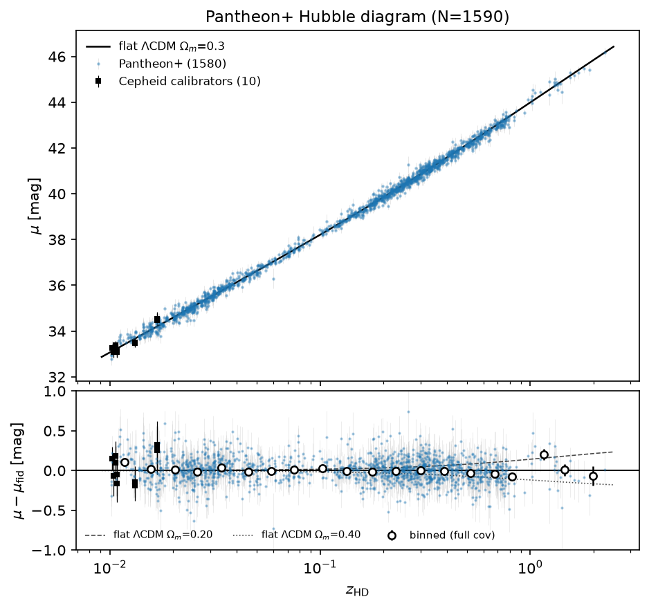
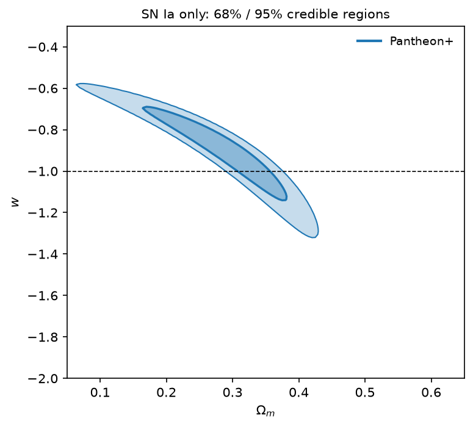
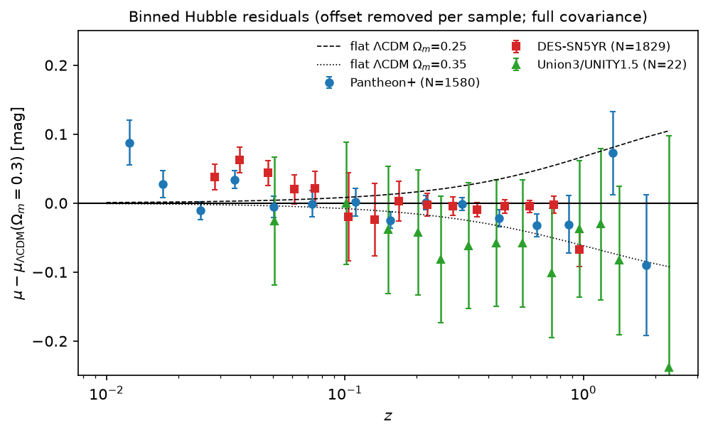
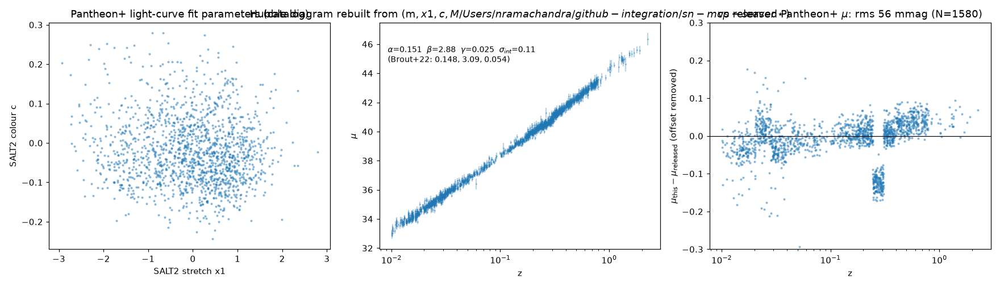
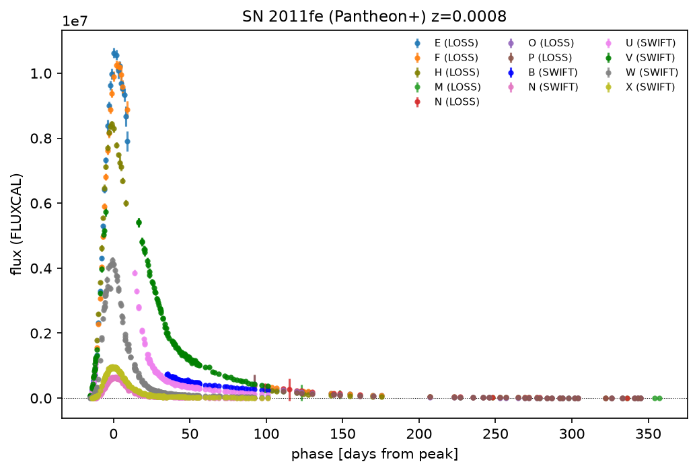

# sn-mcp-server

MCP server for Type Ia supernova cosmology on public data: Pantheon+, DES-SN5YR, Union3/UNITY1.5 and DES-Dovekie.
An agent can fetch Hubble diagrams with their full stat+sys covariance, plot and bin them, and fit flat ΛCDM, wCDM or w0waCDM.
It can also compare samples, standardise per-SN SALT2/SALT3 fits with the Tripp formula, and plot light curves.

Part of the cosmo data MCP server family (sn · galaxy-surveys · cmb-data · weak-lensing · clusters). Default port: 8010.

## At a glance

| | |
|---|---|
| Surveys | Pantheon+ (18 surveys), DES-SN5YR, Union3/UNITY1.5, DES-Dovekie |
| Tools | 21 (4 catalog, 9 summary statistic, 0 published result, 4 meta, 4 dispatch) |
| Skills | 5 (`skills/`) |
| Bundled data | 0.9 MB (`data/`) |
| Network | First use only: covariances for Pantheon+, DES-SN5YR and DES-Dovekie; DES-SN5YR SALT3 metadata; light curves. Union3 tools and Pantheon+ SALT2 tools run offline. |

## Data

| Dataset | Kind | Content | Shape and type | Source | Access |
|---|---|---|---|---|---|
| Pantheon+ Hubble diagram | Summary statistic | μ(z) (`MU_SH0ES`), zHD, zHEL, calibrator flag for 1701 light curves of 1543 SNe | table, 1701 rows × 47 cols (1590 rows with zHD > 0.01; 77 Cepheid-host calibrators) | Scolnic+22, Brout+22; PantheonPlusSH0ES GitHub | Bundled (579 kB) |
| Pantheon+ covariance | Summary statistic | total stat+sys covariance of μ | matrix (1701×1701), mag² | Brout+22; PantheonPlusSH0ES GitHub | Download (33 MB text), cached as .npy |
| Pantheon+ SALT2 fits | Catalog | per-SN x1, c, mB, x0, errors and covariances, HOST_LOGMASS, bias correction | same file as the Hubble diagram: table, 1701 rows × 47 cols | Brout+22; PantheonPlusSH0ES GitHub | Bundled (579 kB) |
| Pantheon+ light curves | Catalog | multi-band photometry (SNANA `.dat`) | index: table, 1449 files for 1222 SNe × 3 cols; each file: table of MJD, band, flux, flux error, mag | PantheonPlusSH0ES GitHub `1_DATA/photometry` | index Bundled (89 kB); files Download (~10–50 kB each, per SN) |
| DES-SN5YR Hubble diagram | Summary statistic | μ(z), MUERR_FINAL, zHD, zHEL for 1635 DES + 194 low-z SNe | table, 1829 rows × 7 cols | DES 2024, Vincenzi+24; des-science GitHub release 1.3 | Bundled (92 kB) |
| DES-SN5YR covariance | Summary statistic | systematic covariance of μ; stat term added from MUERR_FINAL² | matrix (1829×1829), mag² | DES 2024; des-science GitHub release 1.3 | Download (16 MB gzip), cached as .npy |
| DES-SN5YR SALT3 fits | Catalog | per-SN x1, c, x0, errors and covariances, HOST_LOGMASS, bias correction | table, 1829 rows × 50 cols | Vincenzi+24; des-science GitHub release 1.3 | Download (662 kB), cached |
| DES-SN5YR light curves | Catalog | photometry plus SALT3 model flux (LCPLOT) | table, one row per epoch (MJD, phase, flux, flux error, data/model flag, band) | DES 2024; des-science GitHub release 1.3 | Download (7.4 MB gzip), cached |
| Union3/UNITY1.5 binned Hubble diagram | Summary statistic | μ at 22 redshift nodes from 2087 SNe, with inverse covariance | FITS image 23×23: vector (22) z nodes + vector (22) μ + matrix (22×22) inverse covariance | Rubin+23; rubind/union3_release GitHub | Bundled (8.6 kB) |
| DES-Dovekie Hubble diagram | Summary statistic | recalibrated DES-SN5YR μ(z), MUERR for 1820 SNe | table, 1820 rows × 9 cols (SNANA text) | Popovic+26; des-science GitHub | Bundled (148 kB) |
| DES-Dovekie covariance | Summary statistic | inverse of total stat+sys covariance of μ | matrix (1820×1820), stored as upper triangle vector (1657110) in .npz | Popovic+26; des-science GitHub | Download (6.2 MB), cached |

No published result (chain) is served. `describe_sn_dataset` lists published reference values for comparison only.

### Where the data comes from
- Bundled: the four Hubble-diagram tables, the Pantheon+ SALT2 fit table and the Pantheon+ light-curve index (`data/`, provenance in `data/README.md`). Union3 tools and Pantheon+ SALT2 tools need no network.
- Download: covariances (Pantheon+ 33 MB, DES-SN5YR 16 MB, DES-Dovekie 6.2 MB), DES-SN5YR SALT3 metadata (662 kB), DES-SN5YR LCPLOT (7.4 MB) and Pantheon+ per-SN light curves. All come over HTTPS from `raw.githubusercontent.com` on first use.
- Text covariances are parsed once and cached as `.npy` next to the download.
- Cache: `~/.cache/cosmo-mcp/sn-mcp-server/<dataset>/`. Override the root with `$COSMO_MCP_DATA`.
- Pre-fetch: call `fetch_sn_sample` once per dataset (and `fetch_sn_salt2_params` / `fetch_sn_lightcurve` for DES-SN5YR catalogs).
- No tool queries a live service. Offline, every tool works once its files are bundled or cached.

## Tools

### Catalog tools

| Tool | What it does | Data used | Output | Weight |
|---|---|---|---|---|
| `fetch_sn_salt2_params` | Writes per-SN SALT2 (Pantheon+) or SALT3 (DES-SN5YR) fit parameters with a z cut; mB covariances are converted from x0 space. | Pantheon+ SALT2 fits (Bundled) or DES-SN5YR SALT3 fits (Download) | CSV (18 cols: x1, c, mB, errors, covariances, HOST_LOGMASS, biasCor, released μ, survey, calibrator flag) | light |
| `standardize_sn_salt2` | Fits Tripp α, β, mass step γ and σ_int by maximum likelihood and builds a Hubble diagram; compares μ with the released μ. | Pantheon+ SALT2 fits (Bundled) or DES-SN5YR SALT3 fits (Download) | Hubble-diagram CSV, summary JSON (α, β, γ, σ_int, rms vs released μ) | heavy |
| `fetch_sn_lightcurve` | Downloads and parses the photometry of one SN. | Pantheon+ light curves (Download per SN) or DES-SN5YR LCPLOT (Download) | CSV per light-curve file (mjd, band, flux, flux_err; mag, mag_err for Pantheon+) | light |
| `plot_sn_lightcurve` | Plots a multi-band light curve in flux or magnitude; DES-SN5YR also shows the SALT3 model. | same as `fetch_sn_lightcurve` | PNG | light |

### Summary statistic tools

All take `dataset` = `pantheonplus` | `des5yr` | `union3` | `des_dovekie`, with optional z cuts and Pantheon+ calibrator selection.

| Tool | What it does | Data used | Output | Weight |
|---|---|---|---|---|
| `fetch_sn_sample` | Selects one Hubble diagram with z cuts and calibrator choice, plus the matching covariance block. | Hubble diagram (Bundled) + covariance (Download; Union3 Bundled) | `<dataset>_hd.csv`, `<dataset>_cov.npy` (mag²) | light |
| `compute_distance_modulus` | Computes theory μ(z) for (Ωm, w0, wa, H0, Ωk); radiation neglected. | none | CSV (z, μ, D_L, μ − μ(flat ΛCDM, Ωm = 0.3)) | light |
| `bin_hubble_diagram` | Compresses μ residuals vs a fiducial cosmology into log-z bins by full-covariance GLS. | Hubble diagram + covariance | binned CSV, bin covariance .npy | light |
| `plot_hubble_diagram` | Plots μ(z) with the fiducial curve and a residual panel; binned residuals and calibrators marked. | Hubble diagram + covariance | PNG | light |
| `plot_sn_covariance` | Plots the stat+sys correlation matrix sorted by z; checks positive definiteness. | Hubble diagram + covariance | PNG; mean/max off-diagonal correlation, condition number | light |
| `compute_sn_chi2` | Computes offset-marginalised χ² of one cosmology with the full covariance. | Hubble diagram + covariance | χ², χ²/N, Δχ² vs flat ΛCDM Ωm = 0.3, best offset (no files) | light |
| `fit_sn_cosmology` | Fits flat ΛCDM, wCDM or w0waCDM on a grid with Nelder–Mead refinement; M/H0 offset marginalised analytically. | Hubble diagram + covariance | summary JSON, 1D and 2D posterior / profile-χ² CSVs with 68/95% flags | heavy |
| `plot_sn_contours` | Plots 68/95% HPD contours from one to six 2D CSVs of `fit_sn_cosmology`. | user files (2D CSVs) | PNG | light |
| `compare_sn_samples` | Overlays binned residuals of 2–4 samples (`residuals`), or fits each sample and overlays contours with pairwise Gaussian tension (`contours`). | Hubble diagrams + covariances | PNG, residual CSV or tension JSON | heavy |

### Likelihood

χ² = rᵀC⁻¹r − (1ᵀC⁻¹r)² / (1ᵀC⁻¹1), with r = μ_obs − μ_th(z_HD, z_hel) and C the full stat+sys covariance.
This marginalises the offset M (or H0) over a flat prior, as in the Pantheon+, DES and cobaya likelihoods.
D_L = (1 + z_hel) D_M(z_HD). Distances come from numerical integration (radiation neglected, < 1e-4 mag for z < 3; tested against `astropy.cosmology`).

### Meta and dispatch tools

| Tool | What it does | Data used | Output | Weight |
|---|---|---|---|---|
| `list_sn_datasets` | Lists datasets, filtered by kind, with access and the tools that read each. | registry | JSON | light |
| `describe_sn_dataset` | Gives products, units, conventions, URLs, citation and published reference values of one dataset. | registry | JSON | light |
| `list_sn_skills` | Lists the skills (multi-tool recipes). | `skills/` | JSON | light |
| `load_sn_skill` | Returns the full text of one skill. | `skills/` | Markdown | light |
| `auth_status` | Reports whether this server is signed in to ALCF/NERSC for HPC dispatch. | none | JSON | light |
| `get_dispatch` | Reports where heavy tools run now (local or an HPC facility). | none | JSON | light |
| `set_dispatch` | Sets where heavy tools run: local, polaris (ALCF) or perlmutter (NERSC). | none | JSON | light |
| `export_dispatch_pack` | Exports this server's compute kernels so a client can run them on HPC. | `tools/` | file bundle + kernel manifest | light |

## Example figures

| | |
|---|---|
|  |  |
| Pantheon+ Hubble diagram with residuals (`plot_hubble_diagram`) | SN-only wCDM Ωm–w contours (`fit_sn_cosmology` + `plot_sn_contours`) |
|  |  |
| Binned residuals of three samples (`compare_sn_samples`, mode `residuals`) | Tripp standardisation of Pantheon+ (`standardize_sn_salt2`) |
|  | |
| SN 2011fe light curve (`plot_sn_lightcurve`) | |

## Validation

| Check | This server | Reference |
|---|---|---|
| Pantheon+ flat ΛCDM Ωm (z > 0.01, N = 1590) | 0.332 ± 0.018 | 0.334 ± 0.018 (Brout+22) |
| DES-SN5YR flat ΛCDM Ωm (N = 1829) | 0.353 ± 0.017 | 0.352 ± 0.017 (DES 2024) |
| Union3 flat ΛCDM Ωm (22 nodes) | 0.358 ± 0.027 | 0.356 +0.028/−0.026 (Rubin+23) |
| Pantheon+ wCDM w | −0.91 ± 0.15 | −0.90 ± 0.14 (Brout+22) |
| DES-SN5YR wCDM w | −0.81 ± 0.15 | −0.80 +0.14/−0.16 (DES 2024) |
| Pantheon+ Tripp α, β, γ, σ_int (z > 0.01, no calibrators, N = 1580) | 0.151, 2.88, 0.025 mag, 0.112 mag; rms vs released μ 0.050 mag | α ≈ 0.15, β ≈ 3.0, γ ≈ 0.05 (Brout+22) |
| DES-SN5YR Tripp α, β, γ, σ_int (N = 1829) | 0.177, 3.06, 0.073 mag, 0.173 mag; rms vs released μ 0.037 mag | 0.161, 3.118, 0.038 (Vincenzi+24) |
| μ(z) vs `astropy.cosmology` | agrees (unit test) | astropy |

The Tripp fit uses diagonal per-SN errors, not the full systematic covariance. Differences from the published α, β, γ are expected.

## Skills

| Skill | Use it to |
|---|---|
| `sn-tour` | Run a five-minute local tour: datasets, Pantheon+ Hubble diagram, ΛCDM fits of three samples, residual overlay, wCDM contour. |
| `reproduce-pantheon-plus-om` | Reproduce Pantheon+ Ωm = 0.334 ± 0.018 and w = −0.90 ± 0.14, with checks on z cut, calibrators and covariance. |
| `sn-dark-energy-w0wa` | Fit wCDM and w0waCDM per sample, overlay contours and quantify sample disagreement. |
| `salt2-standardization` | Build a Hubble diagram from per-SN SALT2/SALT3 fits with the Tripp formula. |
| `hpc-dispatch-handoff` | Run `fit_sn_cosmology` on ALCF Polaris or NERSC Perlmutter. |

## Install and run

```bash
python -m venv .venv && .venv/bin/pip install -e ".[dev]"
.venv/bin/python -m mcp_server                 # stdio
.venv/bin/python -m mcp_server --transport streamable-http --port 8010
MPLBACKEND=Agg .venv/bin/python -m pytest -q    # tests (network tests: -m network)
```

Offline tests only: `MPLBACKEND=Agg .venv/bin/python -m pytest -q -m "not network"`. Server smoke test: `.venv/bin/python tests/smoke_server.py`.

## Limitations

- No per-SN Union3 table is public. Union3 is a 22-node compressed Hubble diagram, so calibrator selection and per-SN plots do not apply.
- SALT2/SALT3 catalogs and light curves exist only for Pantheon+ and DES-SN5YR.
- The Tripp standardisation uses diagonal errors. It does not reproduce the full BBC bias-correction pipeline.
- SN data alone barely constrain w0wa. Posteriors often hit the prior edges; the fit flags this.
- `compare_sn_samples` tension ignores the overlap between samples (shared low-z SNe; Union3 contains much of Pantheon+). It under-states the significance of a real difference.
- The absolute offset M/H0 is always marginalised. This server cannot measure H0.
- Published chains are not served. Use the reference values from `describe_sn_dataset` for comparison only.

## Citation

- Pantheon+: Scolnic et al. 2022, ApJ 938, 113 (arXiv:2112.03863); Brout et al. 2022, ApJ 938, 110 (arXiv:2202.04077).
- DES-SN5YR: DES Collaboration 2024, ApJL 973, L14 (arXiv:2401.02929); Vincenzi et al. 2024 (arXiv:2401.02945).
- Union3/UNITY1.5: Rubin et al. 2023 (arXiv:2311.12098).
- DES-Dovekie: Popovic et al. 2026 (arXiv:2511.07517).
- SALT3 (DES-SN5YR fits): Kenworthy et al. 2021.
