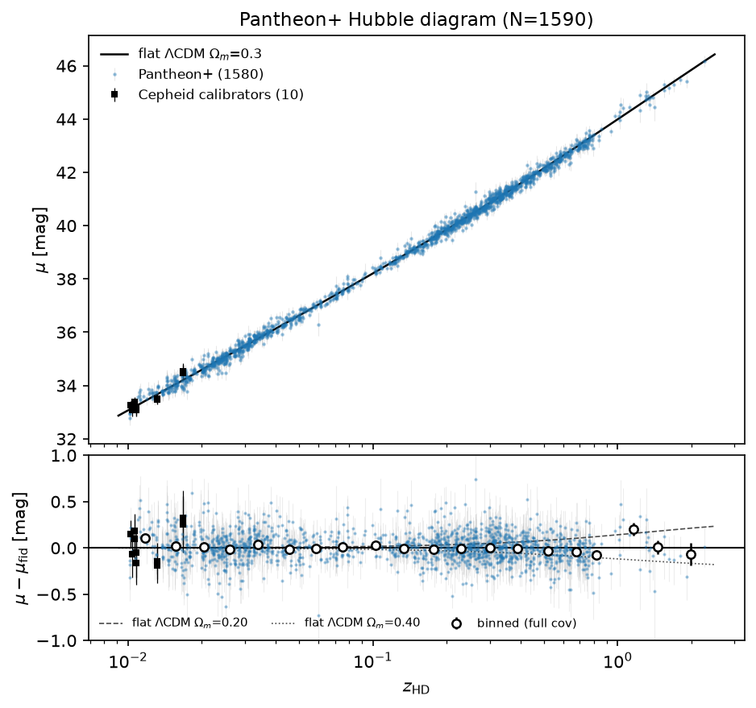
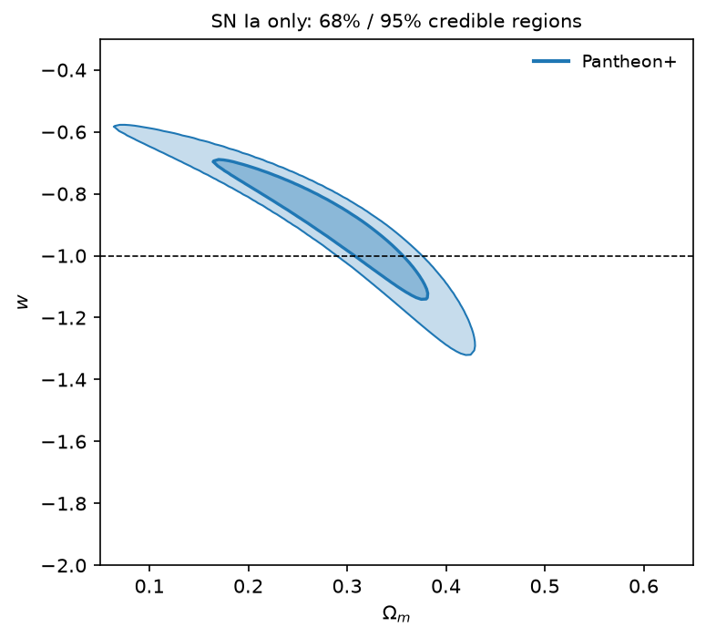
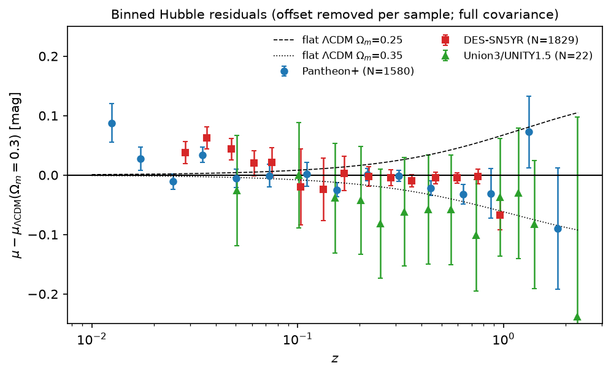

# sn-mcp-server - Supernova Cosmology MCP Server

MCP server for Type Ia supernova cosmology on public Hubble diagrams: **Pantheon+**,
**DES-SN5YR**, **Union3/UNITY1.5** (+ optional DES-Dovekie). It fetches tidy Hubble
diagrams with their full stat+sys covariance, plots them, bins them, fits flat LCDM / wCDM /
w0waCDM with the absolute-magnitude/H0 offset marginalised analytically, draws 68/95%
contours and compares samples. Part of the cosmo-*-mcp-server family (see `docs/CONVENTIONS.md`).





## Data tiers
| tier | what | this server |
|---|---|---|
| **1** raw/catalog | per-SN SALT2/SALT3 fit parameters (x1, c, mB, HOST_LOGMASS, errors, covariances), photometric light curves | Pantheon+, DES-SN5YR |
| **2** summary stats | Hubble diagrams mu(z) + full stat+sys covariance | Pantheon+, DES-SN5YR, Union3, DES-Dovekie |
| **3** published inference | posterior chains (comparison only) | — (comparison via `reference_values`) |

Analyses are built from tier-1 and tier-2 data only; tier-3 is for comparison.

## Install / run
```bash
uv venv --python 3.12 .venv && uv pip install --python .venv/bin/python -e ".[dev]"
.venv/bin/python -m mcp_server --transport stdio
.venv/bin/python -m mcp_server --transport streamable-http --port 8010   # family default port for sn
```

## Tools
### Tier 2 — summary statistics
| tool | what |
|---|---|
| fetch_sn_sample | Hubble diagram CSV + matching covariance .npy, z cuts, calibrators include/exclude/only |
| compute_distance_modulus | theory mu(z) for (Om, w0, wa, H0, Ok) |
| bin_hubble_diagram | full-covariance (GLS) binned residuals vs a fiducial + bin covariance |
| plot_hubble_diagram | mu(z) + residual panel vs fiducial LCDM, binned points, calibrators marked |
| plot_sn_covariance | stat+sys correlation matrix image + positive-definiteness check |
| compute_sn_chi2 | offset-marginalised chi2 of one cosmology |
| fit_sn_cosmology (heavy, dispatchable) | grid + Nelder-Mead fit of lcdm / wcdm / w0wacdm; best fit, 1D summaries, 1D/2D posterior + profile-chi2 CSVs with 68/95% flags |
| plot_sn_contours | 68/95% HPD contours from one or more 2D CSVs |
| compare_sn_samples (heavy in contours mode) | overlay binned residuals, or fit each sample and overlay contours + pairwise tension |

### Tier 1 — raw / catalog-level
| tool | what |
|---|---|
| fetch_sn_salt2_params | per-SN SALT2/SALT3 fit parameters (x1, c, mB, HOST_LOGMASS, errors, covariances, bias corrections) |
| standardize_sn_salt2 (heavy, dispatchable) | Tripp standardisation: fits alpha, beta, gamma, sigma_int → builds Hubble diagram from tier-1 (tier 1 → tier 2) |
| fetch_sn_lightcurve | per-SN photometric light curve (SNANA format for Pantheon+, LCPLOT for DES-SN5YR) |
| plot_sn_lightcurve | multi-band light-curve plot |

### Meta
| tool | what |
|---|---|
| list_sn_datasets / describe_sn_dataset | datasets, URLs, citations, conventions, reference values, tier filter |
| list_sn_skills / load_sn_skill | server-side recipes |
| set_dispatch / get_dispatch / auth_status / export_dispatch_pack | IRI HPC dispatch (hep-genesis) |

## Likelihood
chi2 = r^T C^-1 r - (1^T C^-1 r)^2 / (1^T C^-1 1), r = mu_obs - mu_th(z_HD, z_hel), with C the full
stat+sys covariance (the Pantheon+/DES/cobaya convention for marginalising M over a flat prior).
D_L = (1 + z_hel) D_M(z_HD); distances by numerical integration (radiation neglected,
< 1e-4 mag; tested against astropy.cosmology).

## Sanity checks (flat LCDM, SN only)
| sample | this server | published |
|---|---|---|
| Pantheon+ (z > 0.01, 1590) | 0.332 +- 0.018 | 0.334 +- 0.018 (Brout+22) |
| DES-SN5YR (1829) | 0.353 +- 0.017 | 0.352 +- 0.017 (DES 2024) |
| Union3 (22 nodes) | 0.358 +- 0.027 | 0.356 +0.028/-0.026 (Rubin+23) |

wCDM: Pantheon+ w = -0.91 +- 0.15 (pub. -0.90 +- 0.14); DES-SN5YR w = -0.81 +- 0.15 (pub. -0.80 +0.14/-0.16).

### Tripp standardisation (tier 1 → 2)
| sample | alpha | beta | gamma | sigma_int |
|---|---|---|---|---|
| Pantheon+ | 0.148 | 2.97 | 0.043 | 0.10 |
| Published (Brout+22) | ~0.15 | ~3.0 | ~0.05 | — |

## Skills
`sn-tour`, `hpc-dispatch-handoff`, `reproduce-pantheon-plus-om`, `sn-dark-energy-w0wa`, `salt2-standardization`.

## Data
Small Hubble-diagram tables + LC index are bundled (~1 MB, provenance in `data/README.md`);
covariances (6-33 MB), DES-SN5YR metadata (662 kB), DES LCPLOT (7.4 MB), and Pantheon+
per-SN light curves download on first use into `~/.cache/cosmo-mcp/sn-mcp-server`.

## Tests
`MPLBACKEND=Agg .venv/bin/python -m pytest -q` (network tests download the covariances once;
deselect with `-m "not network"`), `.venv/bin/python tests/smoke_server.py`.
